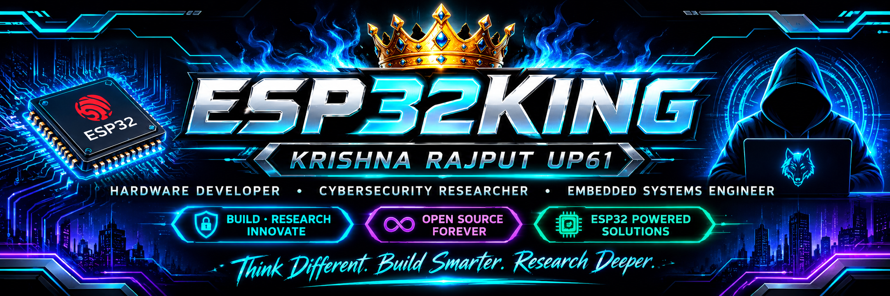

# KRISHNA RAJPUT UP61

### EMBEDDED SYSTEMS · HARDWARE DEVELOPMENT · CYBERSECURITY RESEARCH

 

---

## ⚡ I'M BACK — A NEW CHAPTER BEGINS

**Not a comeback. A new chapter.**

*I'M BACK. BUILT DIFFERENT. POWERED BY ESP32.* ⚡

## 👑 About ESP32KING

I'm **Krishna Rajput**, also known as **ESP32KING** and **Krishna UPX61** — an independent hardware developer interested in embedded systems, ESP32 firmware, wireless technologies, and practical security research.

I build and experiment with:
- Custom ESP32 firmware and embedded hardware projects
- Wireless communication and local-network applications
- Hardware automation and BLE/HID experimentation
- Network diagnostics and controlled security demonstrations
- Browser-based tools for firmware deployment and device diagnostics

> **My philosophy:** Don't just use technology. Understand it, experiment with it, and build something better.

**Mission:** Build · Research · Experiment · Innovate

## 🧭 Research & Development Areas

| Area | What I explore |
|---|---|
| Embedded systems | ESP32 boards, firmware, peripherals, and device integration |
| Wireless technologies | Wi-Fi, Bluetooth Low Energy, and local communication |
| Network diagnostics | DNS/HTTP behaviour and local network monitoring |
| Embedded security | Firmware behaviour and security testing in controlled labs |
| Hardware automation | Authorized HID and device-interaction experiments |
| Web tooling | Browser-based interfaces and Web Serial applications |

All security-related work is intended for systems, devices, and networks that I own or am explicitly authorized to test.

## 🚀 Featured Project — Royal Web Flasher

### YOUR ESP32. YOUR FIRMWARE. YOUR BROWSER.

A browser-based ESP32 firmware flashing and chip-diagnostics platform built around the **Web Serial API**.

### Core capabilities

| Feature | Description |
|---|---|
| Firmware flashing | Deploy compatible custom `.bin` firmware |
| Chip diagnostics | Read available ESP32 chip information |
| MAC detection | Display device MAC information when available |
| Crystal detection | Identify crystal frequency where supported |
| High-speed serial | Baud-rate support up to 921600, depending on device/browser |
| Flash erase | Erase device flash when selected |
| Compressed upload | Support for compatible compressed firmware workflows |
| Auto reset | Device reset support where the board allows it |
| Serial monitor | View live serial output |
| Log tools | Copy diagnostic logs quickly |

**Website:** [esp32king.pages.dev](https://esp32king.pages.dev)

## 🏆 Flagship ESP32 Projects

### 01 · ESP32-WiFi-Chat
**OFF-GRID COMMUNICATION · LOCAL WI-FI · ESP32**

A local communication concept designed to let nearby users exchange messages over an ESP32-hosted Wi-Fi network without depending on an internet connection.

- ESP32-hosted local Wi-Fi access point
- Captive-portal style browser access
- Browser-based multi-user messaging
- Custom username selection
- On-device message history, depending on firmware/storage configuration
- Off-grid and low-connectivity communication experiments

**Repository:** [ESP32-WiFi-Chat](https://github.com/Esp32-WiFi-Chat)

### 02 · ESP32-WiFi-Sniffer
**WIRELESS RESEARCH · NETWORK DIAGNOSTICS**

An embedded platform for learning about wireless networks and observing network behaviour in controlled environments.

- Wireless network diagnostics
- Captive-portal demonstrations in a lab
- DNS traffic observation
- HTTP request analysis in authorized test environments
- Local web-based administration interface
- Educational network-security experiments

**Repository:** [ESP32KING repositories](https://github.com/esp32king2?tab=repositories)

### 03 · ESP32-WiFi-Keyboard-Mouse
**HID · WI-FI · BLE · HARDWARE AUTOMATION**

A wireless input and hardware-automation project exploring ESP32-based control interfaces.

- Browser-based keyboard-control interface
- Wireless mouse-control concept
- Local-network communication
- Bluetooth Low Energy HID experimentation
- Configurable automation workflows for authorized devices

**Repository:** [ESP32-WiFi-Keyboard-Mouse](https://github.com/Esp32-WiFi-Keyboard-Mouse)

### 04 · ESP32-FRP-BYPASS
**ANDROID DEVICE RESEARCH · HARDWARE AUTOMATION**

An ESP32 hardware-automation research project focused on understanding device interaction and authorized Android servicing workflows.

- ESP32 controller and firmware experimentation
- HID concepts and device-interaction research
- Embedded automation development
- Testing limited to devices the operator owns or is authorized to service

**Note:** This project description is a high-level research overview, not a guide to defeating device security or accessing someone else's device.

### 05 · ESP32-WiFi-Repeater
**EMBEDDED NETWORKING · CONNECTIVITY EXPERIMENTS**

An experimental project exploring wireless connectivity and networking concepts using ESP32 hardware.

- Wi-Fi connectivity experiments
- Network-extension and bridging concepts
- Connection management
- Embedded networking research

**Explore:** [ESP32KING repositories](https://github.com/esp32king2?tab=repositories)

## 🌍 REAL-WORLD RECOGNITION & PROJECT REFERENCES

This section records public references related to the projects. A reference does not automatically mean endorsement, partnership, official adoption, or deployment by an organization.

### ESP32-WiFi-Chat — Third-party product reference

The ESP32-WiFi-Chat project is referenced/credited in a third-party listing for an off-grid Wi-Fi chat server concept.

- **Listing:** [Spartan Off-Grid WiFi Chat Server — Etsy](https://www.etsy.com/listing/4565840379/spartan-off-grid-wifi-chat-server-txt)
- **Related project:** [ESP32-WiFi-Chat on GitHub](https://github.com/Esp32-WiFi-Chat)

The listing describes local browser-based messaging over an off-grid Wi-Fi setup. It is included as a public product reference; it is **not evidence of use by major organizations or institutional customers**.

### Bluetooth HID — Related community resources

- **Article:** [Turn your ESP32 into Bluetooth HID](https://linuxndroid.com/2025/07/turn-your-esp32-into-bluetooth-hid.html)
- **Repository:** [Linuxndroid/Bluetooth-Ducky](https://github.com/Linuxndroid/Bluetooth-Ducky)

These links are related community resources for ESP32 Bluetooth HID experimentation. They are not presented as ESP32KING projects, partnerships, or endorsements.

### Recognition & collaboration

I welcome verifiable project references, constructive technical feedback, open-source contributions, and responsible collaboration. If you use or adapt one of my projects, please provide accurate attribution and share a public reference.

## 🛠️ Tech Stack & Hardware Arsenal

### Embedded hardware

  
  
  
  
  

### Programming & web

  

### Wireless, networking & protocols

- IEEE 802.11 Wi-Fi
- Bluetooth Low Energy (BLE)
- UART and serial communication
- DNS and HTTP
- Web Serial API
- Embedded web servers
- Captive portal technology
- Human Interface Device (HID) concepts

## 📊 GitHub Analytics

  
  
   
  

## 🐍 Contribution Graph

  

## 🤝 Open-Source & Community

I believe technology should be accessible, practical, and open to responsible experimentation.

I'm interested in:
- Open-source collaboration
- ESP32 and embedded-hardware experimentation
- Responsible security research
- Firmware improvements and testing
- Bug reports and feature suggestions
- Knowledge-sharing with developers and makers

## 📜 License & Attribution

Each repository may have its own license. Many projects may use **Apache License 2.0**, but always check the individual repository's `LICENSE` file before copying, modifying, or redistributing code.

**Creator:** Krishna Rajput UP61  
**GitHub:** [@esp32king2](https://github.com/esp32king2)

## ⚠️ Responsible Use

Projects involving wireless analysis, network diagnostics, HID automation, or embedded security are intended for education, authorized testing, and controlled hardware experimentation.

- Test only devices and networks you own or have explicit permission to assess.
- Respect software licenses, privacy, and applicable laws.
- Do not use project material to access accounts, devices, or networks without authorization.

---

### 👑 ESP32KING

**THINK DIFFERENT. BUILD SMARTER. RESEARCH DEEPER.**

`HARDWARE` × `CYBERSECURITY` × `INNOVATION`

Made with ❤️ by **KRISHNA RAJPUT UP61**

